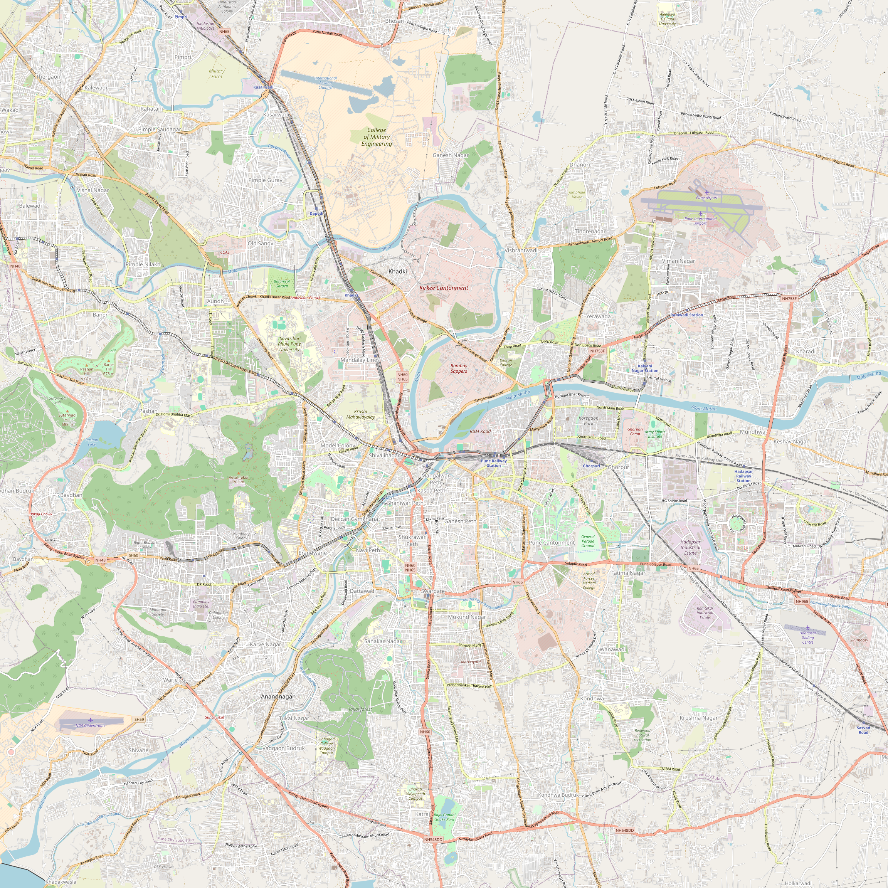
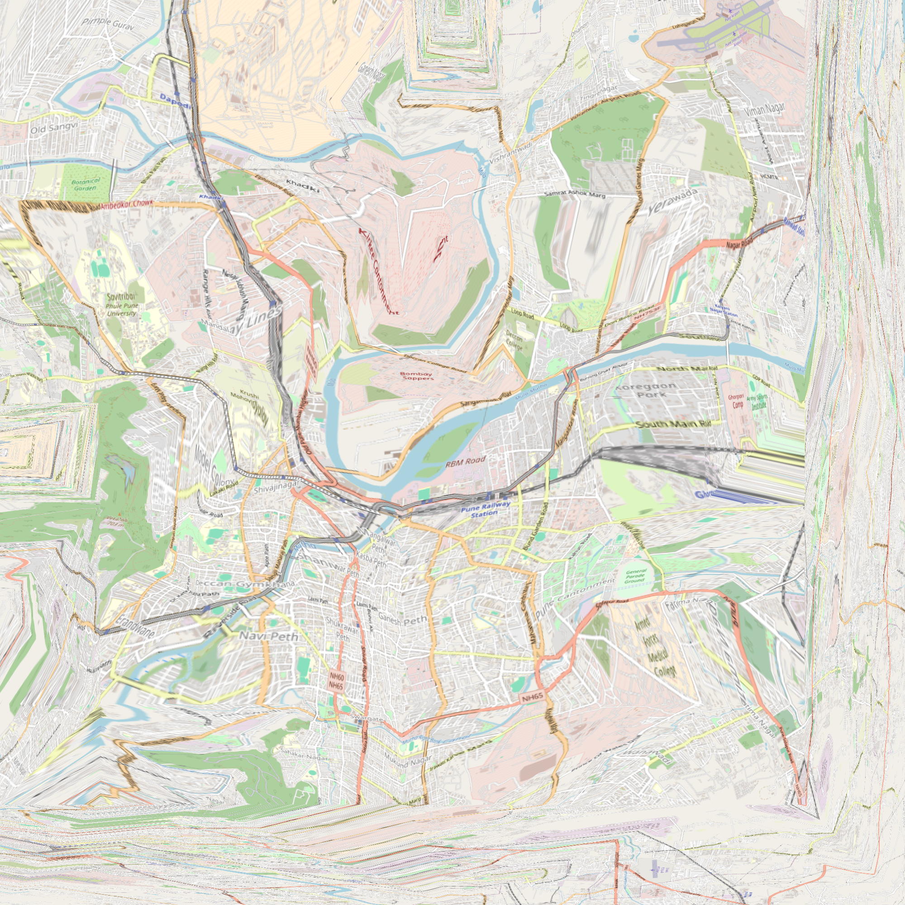
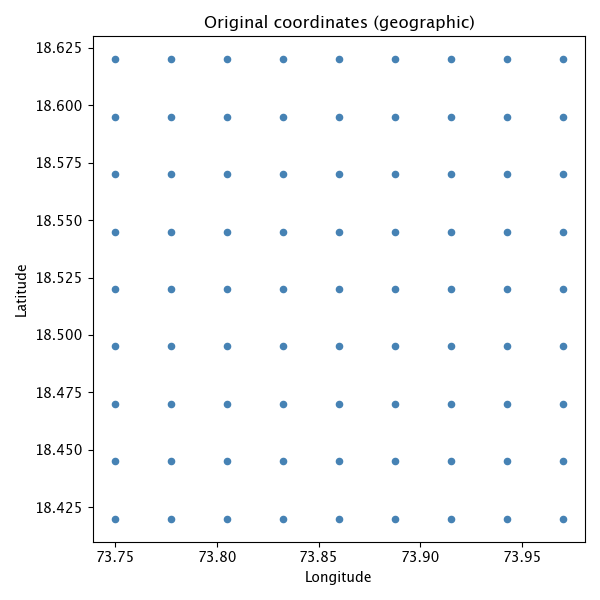
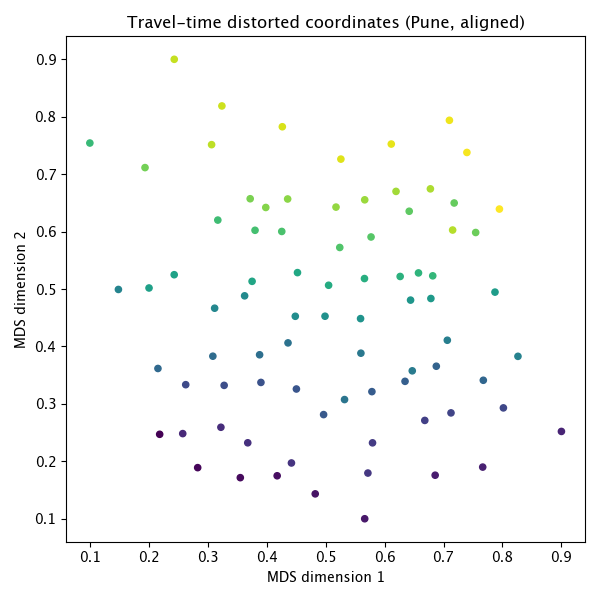

# pune-traveltime-maps

## Visualizing Pune through travel time rather than geographic distance

Adapted from [carstonhernke/traveltime-maps](https://github.com/carstonhernke/traveltime-maps) 
for Pune, India.

## Original map of Pune

## Travel-time distorted map of Pune

## Coordinate grid (geographic)

## Coordinate grid (travel-time distorted)

## How it works

1. **get_map.py** — Downloads OpenStreetMap tiles centered on Pune 
   (18.54°N, 73.87°E) and stitches them into a single base map image.

2. **generate_coordinates.py** — Creates a 9×9 grid of 81 coordinates 
   covering Pune's bounding box (18.42°N–18.62°N, 73.75°E–73.97°E).

3. **get_travel_times.py** — Queries a local OSRM routing engine for 
   driving time between every pair of coordinates (81×81 = 6561 routes).

4. **mds.py** — Applies Multidimensional Scaling (MDS) to the travel 
   time matrix to place each coordinate in 2D space where distance 
   represents travel time rather than geographic distance. Uses 
   Procrustes alignment to preserve north-south-east-west orientation.

5. **distort_map.py** — Uses OpenCV's remap() function to warp the 
   original map image based on the MDS-distorted coordinates, using 
   cubic interpolation to fill pixels between control points.

## Key observations from the Pune distorted map

- **City center (Pune Railway Station, Shivajinagar)** expands outward — 
  it is highly connected by road and reachable quickly from many directions.
- **Koregaon Park and Yerawada (east)** are pulled closer to center — 
  good road connectivity via the river corridor.
- **Khadki Cantonment (north)** appears stretched — military land creates 
  road detours that increase travel time disproportionately.
- **Erandwane and Deccan (west)** compress toward center — well connected 
  via main arterial roads.

## Tech stack

- [OpenStreetMap](https://www.openstreetmap.org/) — free map tiles
- [OSRM](http://project-osrm.org/) — local routing engine (via Docker)
- [NumPy](https://numpy.org/) — matrix operations
- [scikit-learn](https://scikit-learn.org/) — MDS and coordinate scaling
- [SciPy](https://scipy.org/) — spatial interpolation
- [OpenCV](https://opencv.org/) — image warping

## Setup

### Requirements